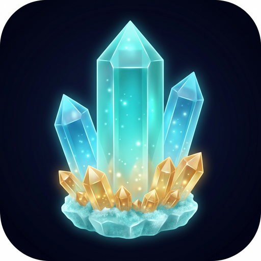

  

<h1 align="center">Quartz</h1>

  Офлайн-заметки, книги и связи между страницами в одном HTML-файле. 
  Offline notes, notebooks and linked pages in a single HTML file. 
  <i>Obsidian × OneNote</i>

  <a href="https://github.com/Finn013/Quartz/releases/latest"><b>⬇️ Скачать / Download</b></a>
  &nbsp;·&nbsp;
  <a href="#русский">🇷🇺 Русский</a>
  &nbsp;·&nbsp;
  <a href="#english">🇬🇧 English</a>

---

# 🇷🇺 Русский

## Что такое Quartz

Quartz — личная база заметок, которая целиком помещается в один файл `Quartz.html`. Откройте его в любом браузере на компьютере или телефоне, и он сразу работает, даже без интернета. Без установки, серверов и регистрации: всё хранится локально в браузере, а при желании синхронизируется между устройствами через ваш собственный репозиторий GitHub.

Quartz — это коллаборация **Obsidian** и **OneNote**: от Obsidian — Markdown, ссылки `[[…]]`, обратные ссылки и граф связей; от OneNote — книги со страницами, свободное оформление, таблицы, колонки и рисование прямо на странице.

## Возможности

### 📚 Книги и страницы
- Книги со страницами и вложенными страницами, перетаскивание, объединение книг.
- Главная с плитками или списком, закрепление, цвета книг, «⭐ Избранное».
- Теги и облако тегов.

### ✍️ Редактор
- Форматирование видно сразу, хранение в Markdown; сокращения `#`, `-`, `1.`, `>`, `[]`.
- Шрифты, размер 9–50, цвет текста, маркер, выравнивание.
- Таблицы с объединением и цветом ячеек, колонки (2–3), картинки, задачи.

### 🔗 Связи
- Ссылки на страницы `[[Страница]]`, на заголовки `[[Страница#Заголовок]]`.
- Обратные ссылки и граф связей.
- Отчёт о битых ссылках; переименование страницы обновляет ссылки.

### 🎨 Рисование и схемы
- Слой рисования поверх страницы: перо, линии, стрелки, фигуры, надписи.
- Отдельные окна схем.

### 🔒 Безопасность
- Пароль на отдельные страницы и книги.
- Зашифрованная полная копия базы и шифрование при синхронизации.

### 💾 Данные и синхронизация
- Экспорт страницы в `.md`, `.html`, `.json`; всей базы в `.json` или `.zip`.
- Импорт JSON, `.md` и `.zip`.
- Полная копия `.quartz` (база, настройки, картинки, рисунки, история).
- Синхронизация через GitHub по токену или через свой REST-сервер, вручную или автоматически.

### 🌗 Оформление
- Светлая и тёмная темы, свои темы, режим E-Ink.
- Полноэкранный режим и режим фокуса.

## Скачать

| Платформа | Файл | Статус |
|---|---|---|
| Любое устройство с браузером | `Quartz.html` | ✅ Доступно |
| Android 7+ | `Quartz.apk` | ✅ Доступно |
| Windows 10/11 | `Quartz-Setup.exe`, `Quartz-Portable.exe` | ✅ Доступно |
| iPhone, iPad, Mac | [finn013.github.io/Quartz](https://finn013.github.io/Quartz/) | ✅ Доступно |

Все файлы — в [релизах](https://github.com/Finn013/Quartz/releases/latest).

**iPhone/iPad:** откройте ссылку в Safari → «Поделиться» → «На экран Домой».
**Mac:** Safari → «Файл» → «Добавить в Dock» (в Chrome/Edge — значок установки в адресной строке).
После первого открытия Quartz работает без интернета.

> Сборки Windows не подписаны: если SmartScreen предупредит, нажмите «Подробнее» → «Выполнить в любом случае».

## Как начать
Откройте Quartz, нажмите «＋ Книга» и начните писать. Подробная инструкция есть в самом приложении (⚙️ → «Инструкция»).

> Данные хранятся на этом устройстве. Делайте резервные копии или включите синхронизацию.

## Идеи и ошибки
Пишите в [Issues](https://github.com/Finn013/Quartz/issues).

---

# 🇬🇧 English

## What is Quartz

Quartz is a personal notes base that fits entirely into one file, `Quartz.html`. Open it in any browser on a computer or phone and it works right away, even offline. No install, no servers, no sign-up: everything is stored locally in the browser and can optionally sync between devices through your own GitHub repository.

Quartz is a blend of **Obsidian** and **OneNote**: Markdown, `[[wiki links]]`, backlinks and a link graph from Obsidian; notebooks with pages, free formatting, tables, columns and drawing on the page from OneNote.

## Features
- 📚 Notebooks with pages and nested pages, drag and drop, pinning, colors, favorites, tags.
- ✍️ WYSIWYG editor stored as Markdown: fonts, sizes, colors, highlights, alignment, tables, columns, images, tasks.
- 🔗 Wiki links `[[Page]]`, backlinks, link graph, broken-link report.
- 🎨 Drawing layer and diagram windows.
- 🔒 Password-protected pages and notebooks, encrypted backups and sync.
- 💾 Export to `.md`, `.html`, `.json`, `.zip`; full `.quartz` backup; sync via GitHub token or your own REST server.
- 🌗 Light, dark and custom themes, E-Ink mode, fullscreen and focus mode.

## Download
- **Any browser:** `Quartz.html`
- **Android 7+:** `Quartz.apk`
- **Windows 10/11:** `Quartz-Setup.exe` or `Quartz-Portable.exe`
- **iPhone, iPad, Mac:** open [finn013.github.io/Quartz](https://finn013.github.io/Quartz/) in Safari and add it to the Home Screen / Dock.

All files are in [Releases](https://github.com/Finn013/Quartz/releases/latest). Windows builds are unsigned; if SmartScreen warns, click “More info” → “Run anyway”.

> The interface is in Russian. Data lives on your device — keep backups or enable sync.
